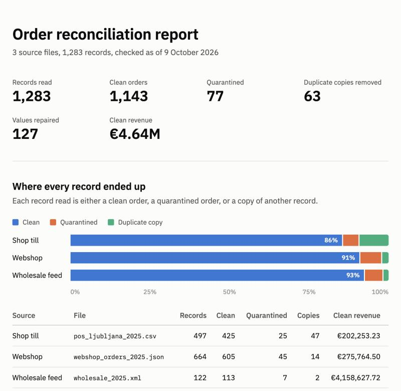

# Clearhouse

[](https://github.com/PuhmeisterLuka/clearhouse/actions/workflows/ci.yml)

Three systems export the same company's orders, and no two of them agree on a format. Clearhouse reads all three, fixes what it can fix without guessing, quarantines the rest, and then grades its own result against a known ground truth.

I generate the data myself. The generator builds a clean set of orders first, writes the messy exports from it, and logs every defect it puts in. So I don't have to look at the output and decide it seems clean. I can count what the pipeline got right.



## Results

On the default dataset the pipeline reads 1,283 records from three files. 1,143 come out as clean orders, 77 go to quarantine, and 63 turn out to be copies of other records. It repairs 127 values on the way. `clearhouse score` then compares that output with the truth:

| Check | Result |
|---|---|
| True orders given the right outcome, clean or quarantined | 1220 / 1220 |
| True orders lost | 0 |
| Orders counted more than once | 0 |
| Output records that aren't real orders | 0 |
| Duplicate copies removed and paired with their original | 63 / 63 |
| Records wrongly removed as copies | 0 |
| Injected defects handled as expected | 268 / 268 |
| Errors and warnings with no defect behind them | 0 |
| Fields on clean orders matching the truth | 8001 / 8001 |
| Clean revenue in EUR, reported vs true | €4,636,645.45 vs €4,636,645.45 |

<details>
<summary>Score by defect kind</summary>

| Defect | Expected handling | Injected | Handled |
|---|---|--:|--:|
| `bad_date` | quarantine | 9 | 9 |
| `buyer_code_noise` | fix | 6 | 6 |
| `cross_channel_duplicate` | dedupe | 47 | 47 |
| `duplicate_order` | dedupe | 16 | 16 |
| `duplicate_row` | dedupe | 12 | 12 |
| `email_noise` | fix | 20 | 20 |
| `euro_price_variant` | fix | 1 | 1 |
| `future_date` | quarantine | 12 | 12 |
| `missing_currency` | fix | 7 | 7 |
| `missing_sku` | quarantine | 12 | 12 |
| `mojibake` | fix | 10 | 10 |
| `name_variant` | fix | 7 | 7 |
| `negative_qty` | quarantine | 11 | 11 |
| `price_cents_error` | fix | 18 | 18 |
| `qty_text` | fix | 8 | 8 |
| `sku_variant` | fix | 17 | 17 |
| `total_mismatch` | fix | 22 | 22 |
| `unknown_sku` | quarantine | 33 | 33 |

</details>

A perfect score needs a caveat. I wrote the generator and the pipeline together, so it only shows that the pipeline handles the defects it was built for. The [limits](#limits) are further down.

The tests take a correct run's output and break it in seven ways, like losing an order or counting one twice, and the scorer has to name each problem. So a perfect score at least isn't the scorer saying yes to everything. The score also holds on 30 seeds the pipeline wasn't developed against, and on 15 more at four times the defect rate. CI reruns six seed and defect-rate combinations on every push.

## The data

Velo Supply is a made-up Slovenian bike-parts distributor with three sales channels. Each one exports orders its own way:

| Source | File | What's awkward about it |
| --- | --- | --- |
| Shop till, Ljubljana | `pos_ljubljana_2025.csv` | Windows-1250 encoding, semicolons, Slovenian headers, a junk preamble and footer, decimal commas, local time with DST, one row per line item, anonymous walk-in sales |
| Webshop API | `webshop_orders_2025.json` | Nested orders, three timestamp styles (UTC, offset, epoch ms), EUR/USD/GBP, prices as strings or numbers, webhook retries, double-encoded names |
| Wholesale feed | `wholesale_2025.xml` | Prices in cents, dates as `YYYYMMDD`, buyer codes instead of emails, attribute names that changed between versions |

Click-and-collect orders show up twice: once in the webshop export, and again in the till's when the customer picks the order up. Staff usually type the web order number into the till's `Ref` field, but about a third of the time they don't.

The pipeline also gets a product catalog, a CRM customer list and monthly FX rates, and trusts those as given.

Every defect the generator injects goes into a ledger, marked with what a correct pipeline should do with it: fix it, quarantine the order, or drop a copy.

## How it works

| Stage | What it does |
| --- | --- |
| Ingest | Reads each file into the same raw record shape. Values stay as written, and every record points back to its line or element in the source file. |
| Parse | Turns each raw value into a typed one. A parser returns the value, with a note if it had to repair something, or refuses it. |
| Check | Looks at one order against the catalog and FX rates: unknown SKUs, quantities below 1, dates in the future, prices written in cents, repeated rows, header totals that disagree with the lines. |
| Reconcile | Looks across orders. It finds each customer in the CRM, drops records a source sent twice, matches till pickups to their web orders, and converts totals to euros. |
| Report | Writes clean `orders`, `lines` and `customers` tables, a quarantine file with reasons, a duplicates file, the full issue log and an HTML report. |
| Score | A separate command. It reads only the output files and the ground truth, and grades the run. |

Every issue has a severity. An error means the order can't be trusted, so it goes to quarantine. A warning means something was wrong but the order is still usable, because the pipeline repaired the value or dropped one the order can do without. Info is worth knowing and needs no action.

### Decisions worth explaining

Adapters don't clean anything. `"10,50"`, `" BRK-0042 "` and `"2 pcs"` reach the parser as the source wrote them. Deciding what a value means is cleaning, and I want every cleaning step in the issue log with the original value next to it.

Parsing fixes only what it can fix without guessing. `brk_42` can only mean `BRK-0042`, so the parser fixes it and logs the change. The till writes decimal commas, so `1.234,56` is fine, but `12.50` isn't a thousands grouping. The parser refuses it rather than read it as 1250.

Orders with an error don't get repaired. An early version "fixed" the totals of orders with negative quantities by recomputing them from numbers it already knew were wrong. Now the validations run on every order, so the log shows every problem, and the repairs stop at the first error.

A repeated line isn't automatically a duplicate, because people do buy the same part twice. The pipeline drops a repeat only when the order's own total says it shouldn't be there. When the header total and the lines disagree for any other reason, the lines win, since they're the more detailed record.

The pipeline matches customers by buyer code or email, never by name. People type names by hand, which is how the data ends up with `NOVAK ŽIGA` and `Tomaz Krajnc`. Once it finds the customer, the order takes the CRM's spelling.

For click-and-collect, the till receipt is the copy. The sale happened online, and counting both would double the revenue. The pipeline matches receipts with a valid `Ref` first. It then compares every receipt still unmatched with the web orders waiting for pickup: same customer, same items, same total, picked up within seven days. That only counts when exactly one web order fits. If two fit, the receipt stays a separate sale and gets a flag, because picking one would be a guess.

The scorer never imports pipeline code. It reads the CSVs the run wrote and judges only those. It also counts false alarms, meaning errors and warnings on orders with no defect behind them. Without that, a pipeline that flagged everything would look thorough.

The generator keeps its own copy of the business rules, like the time zone and which countries pay in which currency, instead of importing the pipeline's. If they shared one, a wrong rule would produce data that agrees with itself, and the scorer could never catch it.

### Bugs the truth comparison caught

Comparing every parsed value with the truth found bugs I wouldn't have spotted by reading the output.

`Š` in UTF-8 is the bytes `C5 A0`, and `A0` in Windows-1252 is a non-breaking space. My parser tidied whitespace before undoing the mojibake, so `Å\xa0pela` became `Å pela` and could never be recovered.

The generator had a bug of its own. It stripped the accents from "Ana Smith", which has none, and logged that as a defect. The ledger then listed one more defect than the pipeline had fixed, and the one it "missed" had changed nothing.

## Running it

You need [uv](https://docs.astral.sh/uv/) and Python 3.12 or newer.

```bash
uv run clearhouse generate
```

Writes `data/raw`, `data/reference` and `data/truth`. The pipeline never reads `data/truth`, only the scorer does. `--seed` gives a different dataset, and `--defect-rate` (default 0.2) sets the share of orders that get a defect.

```bash
uv run clearhouse run
```

Runs the pipeline over `data/raw` and writes `out/report.html` and the CSV tables. Orders dated after `--as-of` (default: today) are rejected.

```bash
uv run clearhouse score
```

Grades `out/` against the truth, prints the result and saves it to `out/score.md`. It exits with status 1 if anything is off, so CI can fail on it.

## Limits

The defects are the ones I thought to inject. Real exports break in ways nobody planned for, and this score says nothing about those.

Each order gets at most one defect, so the pipeline has never seen an order that's broken in two ways at once.

Matching a pickup without a `Ref` needs the same items and the same total. If a customer changes the order at the counter, the receipt and the web order both count as sales.

The catalog, the CRM and the FX rates are trusted as given. A wrong list price would make the price check wrong too.

Everything is held in memory. That's fine for a few thousand orders and wouldn't be for millions.

## Development

```bash
uv run ruff check . && uv run mypy && uv run pytest
```

CI runs these on Python 3.12, 3.13 and 3.14. It then runs generate, run and score on three seeds at two defect rates. Each score shows up on the run's summary page, and each report is saved as an artifact.

## Where things are

| Module | What it does |
| --- | --- |
| [`generate/truth.py`](src/clearhouse/generate/truth.py) | The clean world: catalog, customers, FX rates and orders |
| [`generate/mess.py`](src/clearhouse/generate/mess.py) | Defect injectors, the three format writers and the ledger |
| [`ingest/`](src/clearhouse/ingest) | One adapter per source format, all producing the same raw records |
| [`parse/`](src/clearhouse/parse) | Reusable field parsers, and each source's format |
| [`check.py`](src/clearhouse/check.py) | Order rules against the catalog and FX rates |
| [`reconcile.py`](src/clearhouse/reconcile.py) | CRM customers, repeated records, till pickups, euro totals |
| [`pipeline.py`](src/clearhouse/pipeline.py) | Runs ingest, parse, check and reconcile in order |
| [`export.py`](src/clearhouse/export.py), [`report/`](src/clearhouse/report) | The CSV deliverables and the HTML report |
| [`score.py`](src/clearhouse/score.py) | Grades a run's output files against the ground truth |
| [`model.py`](src/clearhouse/model.py), [`issues.py`](src/clearhouse/issues.py) | The order record, and the issue every stage logs against it |
